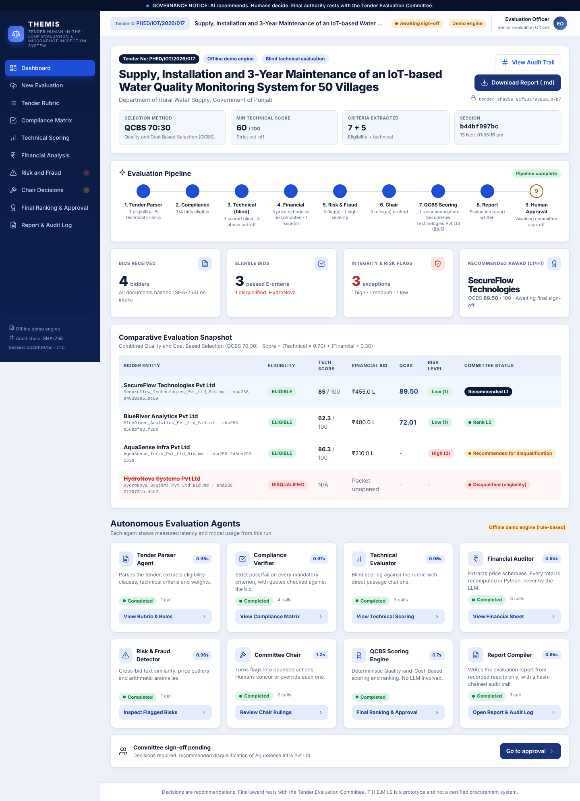

# T.H.E.M.I.S

**Tender Human-in-the-loop Evaluation & Misconduct Inspection System**

A multi-agent AI committee that evaluates public-procurement bids: eligibility checks, blind technical scoring, price verification, fraud detection, QCBS ranking and a tamper-evident audit trail. The AI recommends and a human decides.



## Quick start

**Requirements:** Python 3.10+ (nothing else; the frontend has no build step).

```bash
# macOS / Linux
./run.sh

# Windows
run.bat
```

Open **http://localhost:8000**. The first run creates a virtualenv and installs dependencies.

### Use Groq (gpt-oss)

1. Create a key at https://console.groq.com
2. Put it in `.env` (created from `.env.example` on first run):
   ```
   GROQ_API_KEY=gsk_...
   ```
3. Restart. The top bar shows **Groq · gpt-oss** instead of **Demo engine**.

Models: `openai/gpt-oss-120b` (default) or `openai/gpt-oss-20b`, selectable per run along with the reasoning effort.

### Offline demo mode (no key needed)

Without `GROQ_API_KEY` a **rule-based engine stands in for the LLM** (regex and counting heuristics on the same payloads). It exists so you can explore the whole app, and so the tests run offline. The pipeline, UI, audit chain and approvals are real, but the scores in demo mode come from simple heuristics, not a language model. The UI says so wherever it matters.

## Try it in 60 seconds

1. **New Evaluation** > **Load demo data**: a synthetic tender and four bids with planted issues.
2. **Run Evaluation Committee**: watch the agents work in the live overlay.
3. Open the screens and see what the committee caught:

| Bid | Planted issue | Where it shows |
|---|---|---|
| SecureFlow | Clean, submitted first | Ranked L1 |
| HydroNova | Turnover below threshold, ISO certificate missing | Compliance matrix (E2, E5 fail) |
| AquaSense | Copied technical text, abnormally low price, claims projects it never lists | Risk & Fraud, Chair rulings |
| BlueRiver | Stated total does not match its own line items | Financial analysis |

4. **Chair Decisions**: concur with or override the Chair's rulings (the ranking recalculates).
5. **Final Ranking & Approval**: sign off. Approval is blocked until every recommended disqualification has a human decision.
6. **Report & Audit Log**: read the report and verify the hash chain.

To test with your own documents, use **New Evaluation** and upload a tender plus one file per bidder (PDF, TXT or MD). `sample_data/` holds the demo files in upload form.

## The committee

| Agent | Role | LLM? |
|---|---|---|
| Tender Parser | Tender document to structured rubric (criteria, weights, cut-off) | yes |
| Compliance | Pass/fail per mandatory criterion with a quoted, **verified** evidence passage (BM25 retrieval) | yes |
| Technical Evaluator | Scores each criterion on **anonymised** bids, citing evidence | yes |
| Financial Evaluator | Extracts price schedules; **every total is recomputed in Python** | extraction only |
| Risk / Fraud | Copied text (5-word shingles), price outliers vs median, arithmetic errors, inconsistent claims | partly |
| Chair | Maps each flag to one action from a fixed list; humans concur or override | yes |
| QCBS Scoring | Weighted technical + financial score and ranking | **no** |
| Report | Writes the report from recorded results only | yes |

```
Tender -> Parser -> Compliance -> Technical (blind) -> Financial -> Risk -> Chair -> QCBS -> Report -> Human approval
```

## Design principles

- **Evidence-grounded:** every verdict and score carries a quote, and the backend checks each quote actually occurs in the document (the UI shows "Quote verified" or a warning).
- **No LLM arithmetic:** totals, price ratios, QCBS scores and rankings are plain Python.
- **Blind technical scoring:** bidder names are replaced with Bidder-A, B, C… before the technical agent sees the text. Revealing identities is a logged action.
- **Bounded Chair:** the Chair can only choose `NO_ACTION`, `REQUEST_CLARIFICATION`, `PENALIZE_10`, `PENALIZE_25` or `RECOMMEND_DISQUALIFY`.
- **Prompt-injection guard:** bid text is treated as data in every agent prompt, and all LLM text is HTML-escaped in the UI.
- **Human in the loop:** concur/override rulings, attest blind scores, add notes, then approve or reject. Approval is hash-sealed.
- **Tamper-evident audit:** every event is appended to a SHA-256 hash chain; **Verify chain** recomputes it.
- **Faithful to the tender rules:** financial envelopes are opened only for technically qualified bidders, and arithmetic errors are corrected by recomputing from unit prices.

## UI and animations

Dashboard, New Evaluation, Tender Rubric, Compliance Matrix, Technical Scoring, Financial Analysis, Risk & Fraud, Chair Decisions, Final Ranking & Approval, Report & Audit Log.

Animated feedback when something executes: a full-screen run overlay with a live agent stepper and streaming terminal (Server-Sent Events), an animated pipeline stepper, count-up KPIs, growing bars and donut charts, staggered table and card reveals, pop-in heat-map cells, a sliding evidence drawer, toasts, button ripples, a sequential hash-chain verification sweep and a stamp animation on sign-off. All animation respects `prefers-reduced-motion`.

## Project layout

```
THEMIS/
├── run.sh / run.bat          one-command start
├── .env.example              GROQ_API_KEY, model, demo switches
├── backend/
│   ├── requirements.txt
│   ├── app/
│   │   ├── main.py           FastAPI routes + SSE + static hosting
│   │   ├── pipeline.py       orchestrator (parallel per bidder, streams progress)
│   │   ├── actions.py        human rulings, notes, approval, report refresh
│   │   ├── state.py          sessions, hash-chained audit log, persistence
│   │   ├── llm.py            Groq client (retries, JSON-mode fallback) + demo switch
│   │   ├── mock_engine.py    offline rule-based stand-in for the LLM
│   │   ├── documents.py      PDF/text loading, BM25 retrieval, quote verification
│   │   ├── demo_data.py      synthetic tender + 4 bids
│   │   └── agents/           parser, compliance, technical, financial, risk, chair, scoring, report
│   └── tests/                8 tests (pipeline, gating, audit tamper, upload, Groq path with a fake client)
├── frontend/                 no build step: index.html, css/styles.css, js/*.js
├── sample_data/              demo tender + bids as uploadable files
└── docs/                     screenshots, original prototype notebook
```

## API (selected)

| Method | Path | Purpose |
|---|---|---|
| GET | `/api/health` | mode (groq/demo), models, defaults |
| POST | `/api/sessions/demo` | stage the demo tender and bids |
| POST | `/api/sessions` | multipart upload: `tender`, `bids[]`, `meta` |
| POST | `/api/sessions/{id}/run` | start the committee (optional `settings`) |
| GET | `/api/sessions/{id}/events` | SSE progress stream |
| GET | `/api/sessions/{id}` | full results |
| POST | `/api/sessions/{id}/rulings` | concur / override a Chair ruling |
| POST | `/api/sessions/{id}/approval` | approve or reject (gated) |
| GET | `/api/sessions/{id}/audit/verify` | verify the hash chain |
| GET | `/api/sessions/{id}/export/{report.md,ranking.csv,audit.json,full.json}` | exports |

Interactive docs: http://localhost:8000/docs

## Tests

```bash
cd backend && pip install -r requirements.txt && pytest -q
```

## Limitations (please read)

- **Prototype, not a certified procurement system.** It does not implement any statutory process, digital signatures or access control, and it must not be used to make real awards.
- **Groq path:** the code path (parsing, retries, JSON-mode fallback, model and effort parameters) is tested against a fake client. It has not been exercised against the live Groq API, so check the first real run and adjust prompts or `temperature` if your documents need it.
- **Demo engine is heuristic.** Its numbers illustrate the workflow and are not LLM judgments.
- **Text only:** scanned PDFs are rejected (no OCR). Section detection looks for headings such as "Technical Proposal", "Financial Bid" and "Eligibility Documents" and falls back to the whole document when they are missing.
- **Single user, in-memory with JSON snapshots** in `backend/data/sessions/`. There is no login; the officer name is a label stored in the browser.
- **Submission time matters.** When two bids share text, the later one is treated as the likely copier. For uploads, set the real submission times on the intake screen.
- Rankings depend on committee overrides: for example, overriding a disqualification recommendation can put a very low-priced bid first. The system records that decision; it does not second-guess it.

## Prototype notebook

`docs/prototype_notebook.ipynb` is the single-file notebook version of the same committee, useful for experimenting with prompts.
